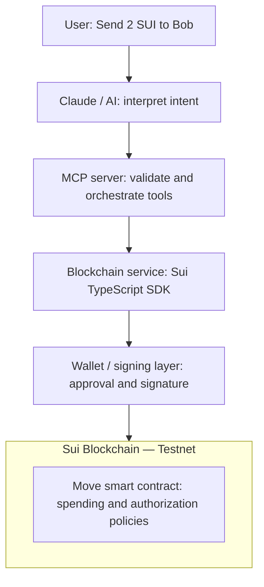

# System Architecture

Source: [overall architecture image](IMG_8992.png).

## Intent

A user expresses an asset operation in natural language, such as “Send 2 SUI to Bob.” Claude or another AI interprets the request and invokes an MCP tool. The MCP server validates and orchestrates the request, while a TypeScript blockchain service builds transactions and queries Sui. A wallet presents transactions for approval and signs authorized transactions. A Move smart contract on Sui Testnet enforces spending limits, recipient restrictions, and authorization rules.

## Layers shown in the image

This reproduces the conceptual transaction path. Balance reads query Sui through the blockchain service without requiring a signature. The image does not specify which component submits signed transactions; the flow document proposes the blockchain service as that component.

| Layer | Responsibility shown in the image | Proposed boundary |
| --- | --- | --- |
| User | Requests an operation | Reviews concrete transaction details before signing |
| Claude / AI | Interprets intent and calls MCP tools | Supplies structured intent; does not hold signing keys |
| MCP server | Exposes transfer, balance, and swap; validates and orchestrates | Validates tool inputs and returns structured outcomes |
| Blockchain service | Uses the Sui TypeScript SDK to build transactions and query Sui | Owns chain-specific logic, amounts, and execution results |
| Wallet / signing layer | Shows transactions for approval and signs authorized transactions | Owns keys and the signing decision |
| Move smart contract | Enforces limits, recipients, and authorization rules | Enforces policy for operations routed through its entry points |

## Proposed trust boundaries

Natural-language interpretation produces a request, not transaction authorization. The MCP server should validate the structured request independently of the model's interpretation.

Wallet approval should show the network, sender, resolved recipient address, asset, amount, and available fee information. The wallet must sign the same transaction that was presented for review. The signing integration and its transport are unspecified in the images.

The Move contract can enforce rules only for operations that invoke it and use assets or capabilities under its control. A direct wallet transfer could bypass that policy. Before implementation, choose how assets are controlled and how every policy-governed transfer reaches the contract.

## Configuration and state

The reference architecture targets Sui Testnet. Proposed runtime configuration includes the network endpoint, expected network, and any Move package or policy object identifiers. Wallet secrets belong to the signing layer and should not be part of tool arguments or model context.

The images do not define persistent server state. If approval or execution spans multiple tool calls, the system will need an operation record connecting the request, prepared transaction, approval, submission, and final result.

## Decisions needed before implementation

| Decision | Why it matters |
| --- | --- |
| MCP transport and AI host integration | Determines server startup and tool invocation |
| Wallet provider and signing interface | Determines how approval requests and signatures travel |
| Transaction submission owner | Avoids duplicate or ambiguous submission responsibilities |
| Move policy and custody model | Determines which assets and transactions policy can govern |
| Recipient resolution | “Bob” needs an explicit, reliable mapping to a Sui address |
| Approval lifecycle | Determines whether transfer is synchronous or returns a pending operation |
| Retry and reconciliation behavior | Prevents uncertain execution from triggering duplicate transfers |
| Swap integration | Requires a provider, quote lifecycle, slippage rules, and approval flow |
