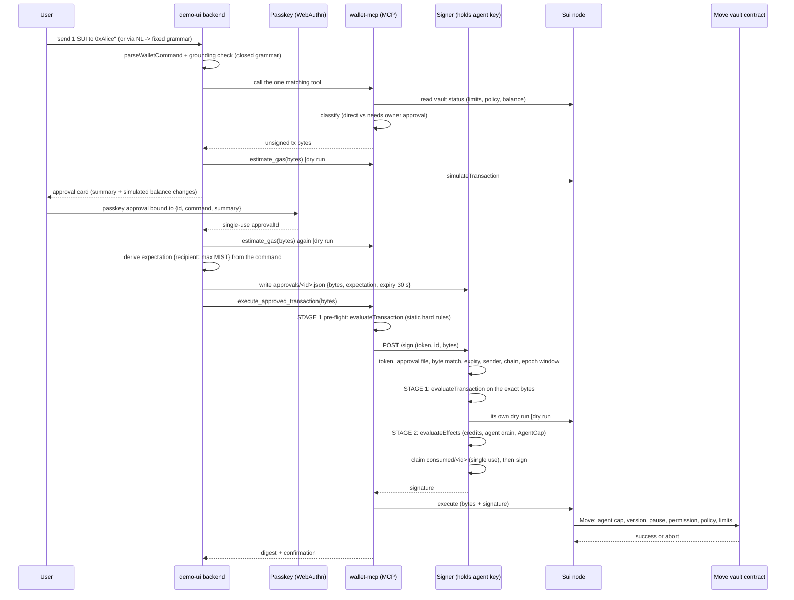

# End-to-end flow with the policy engine

## Layers, in order

| # | Layer | Type | Stops |
| --- | --- | --- | --- |
| 1 | Closed command grammar + grounding | Deterministic | Model inventing actions, recipients, amounts |
| 2 | Tool-side checks (`classifySpend`, balances, paused) | Deterministic, advisory | Obvious failures before the user is bothered |
| 3 | Dry run #1 and #2 (`estimate_gas`) | Simulation, UI side | Transactions that would fail; shows balance changes to the user |
| 4 | Passkey | Human | Approval without a person present. Not verifiable by the signer. |
| 5 | **Stage 1: `evaluateTransaction`** | Deterministic, static | Transfers, SplitCoins, other packages, owner functions, old packages, foreign objects, wrong sender or gas owner, big gas budget |
| 6 | **Stage 2: `evaluateEffects`** on the signer's own dry run | Deterministic over simulated effects | Credits to anyone but the approved recipient (or above the approved amount, or in another coin), agent wallet drained beyond gas, AgentCap moved or deleted, failed simulation |
| 7 | Signer replay protection | Deterministic | Reuse, expiry, wrong chain, wrong epoch window |
| 8 | Move contract | Final enforcement | Everything about vault limits: caps, allowlists, pause, revoke, permissions, stake and trade rules |

Layers 5 and 6 run twice in different places: Stage 1 in the MCP process (clear error) and in the signer (enforcement). Stage 2 runs only in the signer, because it needs a simulation the signer made itself.

## Fail-closed behavior

| Condition | Result |
| --- | --- |
| Stage 1 violation | `403 policy_denied` + reasons; approval not consumed |
| Stage 2 violation | `403 effects_denied` + reasons; approval not consumed |
| Node unreachable during signer dry run | `502 simulation_unavailable`; approval not consumed |
| No expectation in approval and the dry run credits anyone | `effects_denied: unexpected_credit` |

## What each approval expects

| Command | Expectation written for the signer |
| --- | --- |
| `send <amt> SUI to <addr>` | `{ <addr>: amt in MIST }` |
| `execute payment <prop>` | recipient and amount from the owner-approved proposal |
| stake, swap, other | none: the transaction must credit nobody |

## Known limits (still open)

- The expectation comes from the approval file. The signer verifies the transaction against it but cannot verify that the UI wrote the file honestly. Real isolation of the signer (separate OS user) is still F-02/F-03.
- Swap output and stakes stay inside the vault, so Stage 2 sees no credit. `min_out`, stake caps and the price floor are enforced only by the contract.
- Non-coin objects sent to other addresses are not visible in balance changes. Stage 1 blocks transfers and the vault contract only transfers coins, so this relies on that.
- The simulation can differ from execution if state changes between the dry run and inclusion. The contract is the final check.
- The signer's 5 s request timeout now covers one node simulation.
