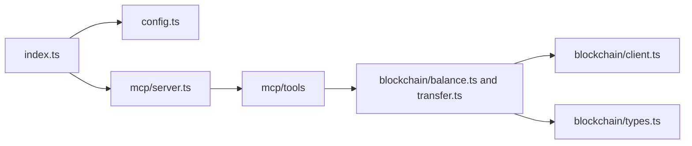

# TypeScript Project Structure

## Proposed layout

```text
wallet-mcp/
├── src/
│   ├── index.ts
│   ├── mcp/
│   │   ├── server.ts
│   │   └── tools/
│   │       ├── getBalance.ts
│   │       ├── transfer.ts
│   │       └── index.ts
│   ├── blockchain/
│   │   ├── client.ts
│   │   ├── balance.ts
│   │   ├── transfer.ts
│   │   └── types.ts
│   └── config.ts
├── package.json
├── package-lock.json
├── tsconfig.json
├── .gitignore
└── README.md
```

## Proposed module responsibilities

The following responsibilities describe the proposed modules in this layout.

| File | Responsibility |
| --- | --- |
| `src/index.ts` | Load configuration, create dependencies, and start the MCP server |
| `src/config.ts` | Parse and validate runtime configuration; centralize network selection |
| `src/mcp/server.ts` | Configure MCP transport and register tools |
| `src/mcp/tools/index.ts` | Export or register the available tool definitions |
| `src/mcp/tools/getBalance.ts` | Define the balance input schema and translate service results into tool responses |
| `src/mcp/tools/transfer.ts` | Validate transfer inputs and orchestrate preparation, approval, and execution |
| `src/blockchain/client.ts` | Construct the Sui client using validated network configuration |
| `src/blockchain/balance.ts` | Query balance data and return typed results |
| `src/blockchain/transfer.ts` | Build transfers and expose submission/result handling through the selected execution interface |
| `src/blockchain/types.ts` | Define shared service inputs, results, and transaction state types |
| `package.json` | Declare dependencies and development/build scripts |
| `package-lock.json` | Record reproducible npm dependency resolution |
| `tsconfig.json` | Configure TypeScript compilation |
| `.gitignore` | Exclude generated output, local configuration, and secrets |
| `README.md` | Explain setup, supported tools, network configuration, and usage |

## Dependency direction



Keep MCP protocol details in `mcp/` and chain-specific transaction/query logic in `blockchain/`. Construct dependencies at startup and pass them to the modules that need them. This allows tool validation and blockchain behavior to be verified separately.

## Additional components to design

The architecture includes a wallet/signing layer and a Move contract whose implementations are not yet specified in the proposed layout. Once the integration decisions are made, add:

- `src/wallet/`: approval and signing interfaces plus the chosen wallet adapter.
- A Move package directory or a separately maintained contract repository: policy implementation and contract tests.
- Operation storage: needed if approval and execution continue asynchronously.
- A swap tool and service module: needed before advertising swap as implemented.

This layout and its additions describe the intended design rather than the current repository contents.
