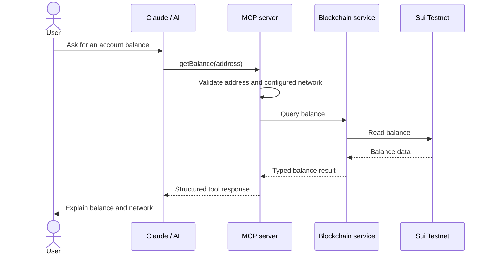

# Tool and Transaction Flows

The following flows and schemas describe proposed interfaces for the [system architecture](architecture.md), not existing API contracts.

## Balance query



A balance query does not require wallet approval. The response should identify the address, network, asset, and amount so the AI can explain what was queried.

Illustrative input:

```json
{
  "address": "<sui-address>"
}
```

Proposed output fields: `network`, `address`, `coinType`, `amountBaseUnits`, and `decimals`. Return base-unit amounts as strings to avoid JavaScript number precision loss. The initial balance scope—SUI only or multiple coin types—remains a design decision.

## Transfer

The following flow proposes that the blockchain service submits the signed transaction after wallet approval and signing. Submission ownership remains an open design decision.

```mermaid
sequenceDiagram
    actor User
    participant AI as Claude / AI
    participant MCP as MCP server
    participant Service as Blockchain service
    participant Wallet as Wallet / signing layer
    participant Sui as Sui Testnet + Move policy
    User->>AI: Send 2 SUI to Bob
    AI->>AI: Resolve Bob to a concrete recipient address
    AI->>MCP: transfer(recipient, amount)
    MCP->>MCP: Validate request
    MCP->>Service: Prepare policy-governed transfer
    Service->>Sui: Query required account and policy data
    Sui-->>Service: Current data
    Service-->>MCP: Prepared transaction and review details
    MCP->>Wallet: Request transaction approval
    Wallet->>User: Show concrete transaction details
    alt User approves
        User->>Wallet: Approve
        Wallet-->>MCP: Signed transaction
        MCP->>Service: Submit signed transaction
        Service->>Sui: Execute transaction
        Sui->>Sui: Enforce Move policy
        Sui-->>Service: Execution result
        Service-->>MCP: Digest and execution status
        MCP-->>AI: Structured result
        AI-->>User: Report result
    else User rejects
        User->>Wallet: Reject
        Wallet-->>MCP: Approval rejected
        MCP-->>AI: Rejected; transaction not submitted
        AI-->>User: Report rejection
    end
```

The recipient resolution mechanism remains an open design decision. A transfer must use a concrete address; an ambiguous name should trigger clarification before transaction preparation. The sender comes from the selected wallet/account, and the network comes from validated runtime configuration.

Illustrative input:

```json
{
  "recipient": "<resolved-sui-address>",
  "amount": "2"
}
```

In this proposed contract, `amount` is a decimal string in SUI units. The service converts it into integer base units using exact decimal arithmetic. Reject zero, negative amounts, excessive decimal precision, and unsupported values rather than silently rounding.

## Validation and result handling

| Stage | Proposed behavior |
| --- | --- |
| Input validation | Validate the recipient, amount, selected account, and network |
| Preparation | Check available funds and gas requirements; construct the correct policy call |
| Review | Present details derived from the actual prepared transaction |
| Approval | Require wallet authorization before signing |
| On-chain execution | Enforce applicable Move policy and inspect the execution outcome |
| Response | Return network, operation identifier if used, digest if known, and explicit status |

Preparation-time checks improve feedback but cannot guarantee execution: chain state can change before submission. The contract must enforce its rules during execution.

A transaction digest identifies a transaction; it alone does not establish successful execution. Report success only after inspecting the execution result. For a submission timeout with an uncertain outcome, reconcile the known transaction identity before deciding whether a retry is safe.

## Proposed operation states

```mermaid
stateDiagram-v2
    [*] --> received
    received --> prepared: validation and construction succeed
    received --> failed: validation or preparation fails
    prepared --> awaiting_approval
    awaiting_approval --> rejected: user declines
    awaiting_approval --> signed: user approves and signing succeeds
    awaiting_approval --> failed: approval session or signing fails
    signed --> submitted: submission accepted
    signed --> unknown: submission outcome uncertain
    signed --> failed: definite submission failure
    submitted --> succeeded: successful execution verified
    submitted --> failed: execution failure verified
    submitted --> unknown: result unavailable
    unknown --> submitted: submission reconciled; result pending
    unknown --> succeeded: successful execution verified
    unknown --> failed: failure verified
    rejected --> [*]
    succeeded --> [*]
    failed --> [*]
```



These states are a suggested design for tracking asynchronous execution. An `unknown` result must remain distinct from a confirmed failure, since repeating an uncertain transfer can move funds twice.

## Verification goals

Before implementation is considered ready, verify that invalid inputs cannot reach transaction submission, balance reads never invoke signing, wallet rejection prevents submission, and approved transaction details match the signed payload. Exercise Move policy violations on Testnet and confirm that failed or uncertain execution is reported accurately. Include precision-boundary amount cases and a submission timeout/reconciliation case.
